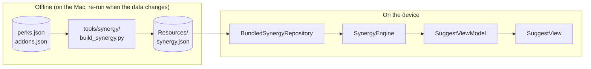
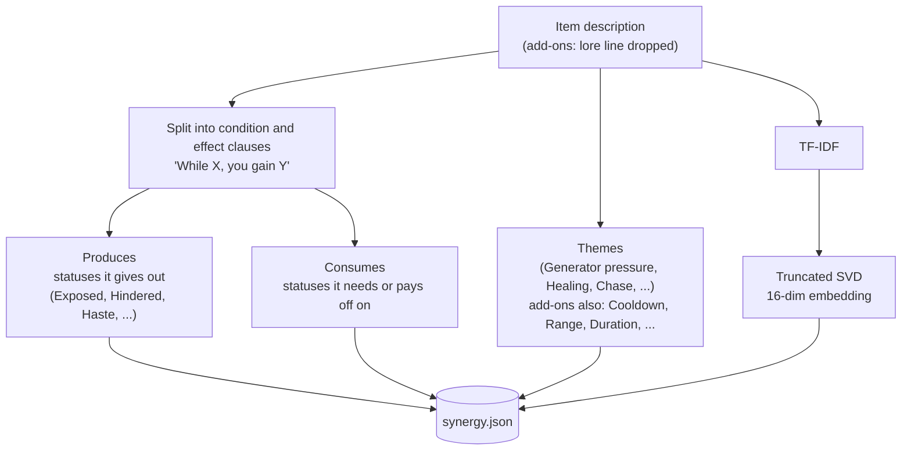
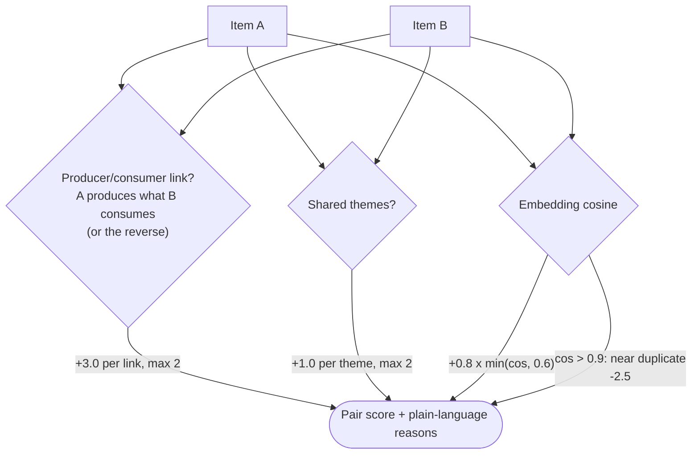
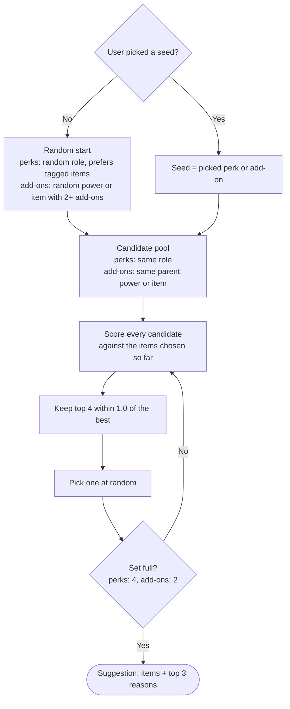
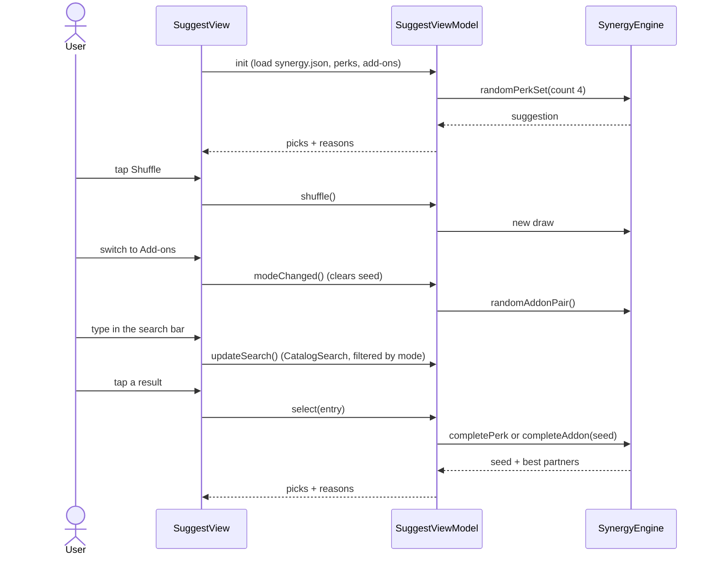

# Suggest tab

The Suggest tab proposes perks and add-ons that support each other. It runs fully on the device: no internet
and no large model. A small model is trained offline from the bundled perk and add-on descriptions.

## 1. Big picture

## 2. What the trainer learns

## 3. How two items are scored

Synergy is complementarity, not similarity: one item gives a status the other one uses.

## 4. How a suggestion is built

## 5. User flow

## Files

| File | Role |
|---|---|
| `tools/synergy/build_synergy.py` | offline trainer (pure Python, no packages) |
| `DBD Perks/Resources/synergy.json` | trained data |
| `DBD Perks/Utils/SynergyData.swift` | data model and bundle loader |
| `DBD Perks/Utils/SynergyEngine.swift` | scoring and suggestion building |
| `DBD Perks/Module/Suggest/` | view and view model |
| `DBD PerksTests/SynergyEngineTests.swift` | engine tests |

## Limits

- There are no "good combo" labels in the data, so quality is a heuristic, not a measured accuracy.
- Only part of the items have a producer/consumer link; the rest rely on themes and the embedding.
