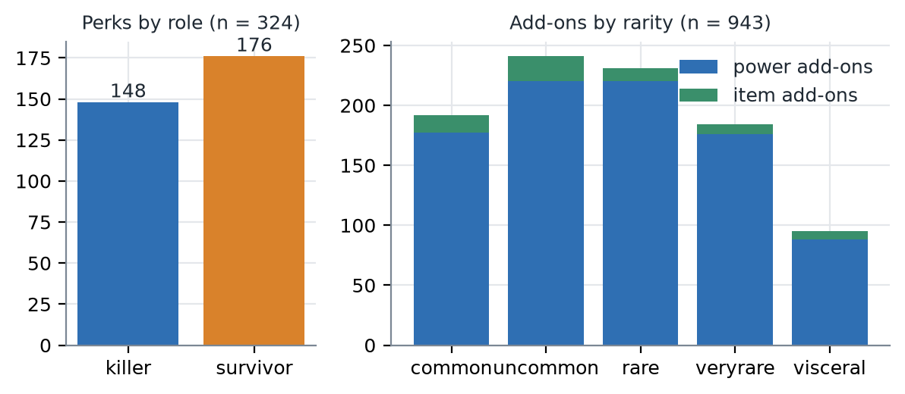
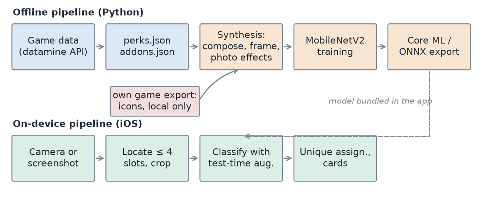
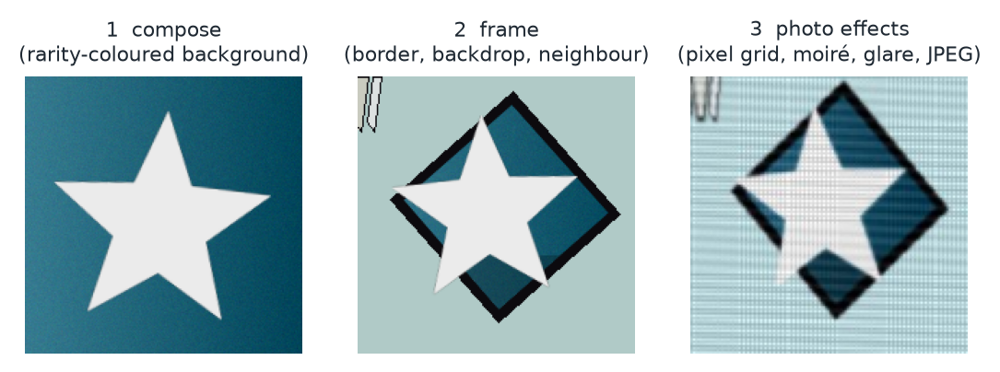
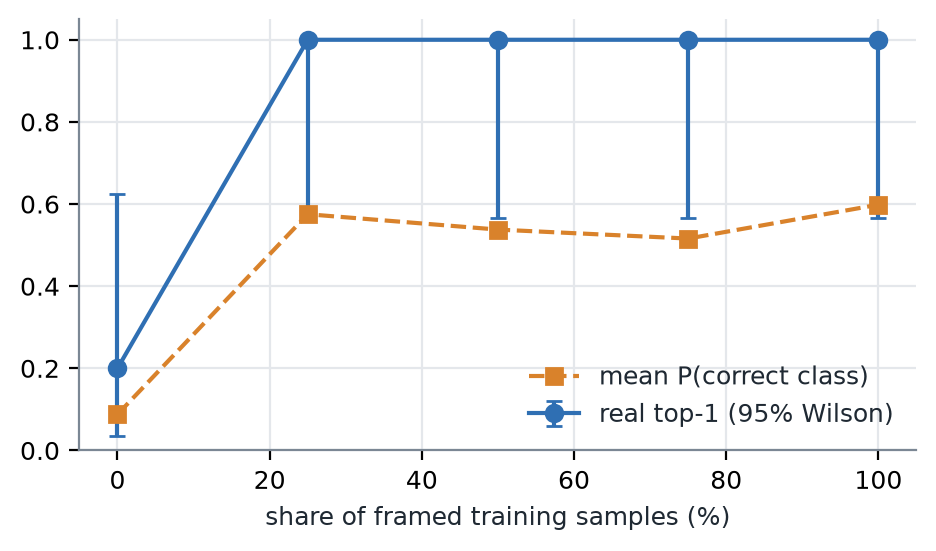
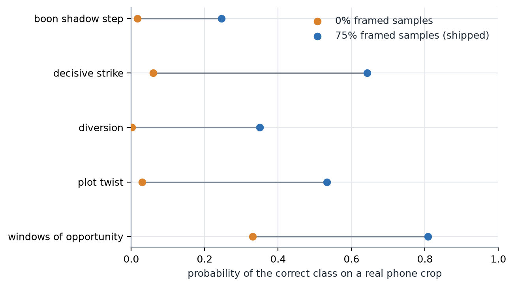

::: {custom-style="Abstract"}
**Abstract.** We build an iPhone app that recognises *Dead by Daylight* perk icons from a photo of a monitor and shows their descriptions without a network connection. A MobileNetV2 classifier trained only on synthetic images reached 99.9% accuracy on a synthetic test set, yet gave the correct class a probability of 0–6% on four of five real phone crops. The cause was not look-alike icons, camera moiré or crop alignment, but a gap in the training distribution: real crops show a black-bordered diamond that fills the crop, chunky UI pixels, a monitor pixel grid and part of the neighbouring slot, and our generator drew none of these. Rendering that "framed" look in 75% of the training samples, with the same network and the same data budget, raised the correct-class probability to 51–92% on the same five crops. We report an ablation over the framed share, with 95% Wilson intervals, and we state plainly that the real test set is still tiny (§7). Everything runs on the device; icons and weights are not redistributed.
:::

# 1 Introduction

Players of *Dead by Daylight* choose four perks per match from several hundred. A player who sees a loadout on a friend's screen, or on a stream, often cannot name the perks and must look each one up. We built an app that does this lookup from a phone photo of the screen: the user points the camera at a loadout, and the app returns up to four description cards.

Recognising a game's UI icons from a photograph of a screen is harder than recognising the same icons in a screenshot. The photograph adds moiré from the monitor's pixel grid, glare, perspective, defocus and JPEG artefacts. The classes are also numerous (324 perks and 943 add-ons at the time of writing) and many icons share a visual style within a game character's set.

Real photographs of screens are slow to collect and label: every class needs several, in every rarity colour. We therefore train on **synthetic** images only and ask what the generator must contain for the result to transfer. Our contributions are:

1. A synthesis pipeline (compose, frame, photo effects) and an on-device pipeline (locate, crop, test-time augmentation, unique assignment) that run offline on an iPhone 12 (§4).
2. A case study of a **synthetic-to-real gap that hid behind a 99.9% synthetic score**, and what did and did not close it (§6).
3. An ablation over the share of framed training samples, reported with confidence intervals on a small real set (§5–6).
4. A frank list of the limits of this evidence, including the sample size (§7).

# 2 Related work

**Domain randomisation.** Tobin et al. [@tobin2017] train on simulated images with widely randomised appearance and transfer to real scenes without real training data. Our generator follows that idea but its randomisation is *targeted*: a flat randomisation of colour, blur and noise (our first generator) did not transfer, while rendering specific structures of the target domain (the frame, the pixel grid) did. This is consistent with domain randomisation working when the randomisation covers the real distribution.

**Backbone.** We use MobileNetV2 [@sandler2018], pretrained on ImageNet [@deng2009], because it runs in real time on a phone's neural engine and exports to Core ML.

**Screen-photo artefacts.** Photographing a display produces moiré patterns that interfere with the image content; learning-based removal exists [@sun2018]. We model moiré as an additive pattern in training rather than removing it, because the classifier only needs to be robust to it.

**Test-time augmentation.** Averaging predictions over several shifted or zoomed views of the same input is a long-standing way to reduce variance [@krizhevsky2012]. We use four views per guided crop.

**Assignment.** A loadout cannot hold the same perk twice, so choosing one candidate per slot is an assignment problem, classically solved by the Hungarian method [@kuhn1955]. With at most four slots and five candidates each, exhaustive search is simpler and fast enough (§4.4).

**Small-sample statistics.** For proportions on few samples we report Wilson score intervals [@wilson1927], which stay inside [0, 1] and behave sensibly at 0% and 100%.

# 3 Data

**Class lists.** Names, owners, descriptions and rarities come from the community datamine API (`dbd.tricky.lol`, game version 10.2.2 for perks). The wiki used at the start of the project lagged behind the game: it listed 282 perks while the game data has 324 (176 survivor, 148 killer), 42 of them new. Of these, 321 have a unique icon and form the classifier's classes; three wiki leftovers have no matching perk in the game data and are not learnable. A background class ("not an icon") brings the perk classifier to 322 classes. Add-ons: 943 entries (881 killer-power and 62 survivor-item add-ons after removing 3 disabled entries), 939 distinct icon stems plus a background class (940 classes). Figure 4 shows the composition.

{width=95%}

**Icons.** Icon images were exported by the author from their own game installation and are used only for training on the author's machine. Icons, add-on images and model weights are Behaviour Interactive's intellectual property and are not redistributed (§8). Only text data (`perks.json`, `addons.json`), class lists and metrics are published.

**Real test crops.** We collected labelled crops of single perks cropped exactly as the app crops them. At the time of writing there are **5** (§7).

# 4 Method

{width=100%}

## 4.1 Synthesis

Each training image goes through three stages (Figure 2). Figure 2 uses a plain star in place of game art; the real pipeline uses the icon of the class being drawn.

1. **Compose.** The icon is scaled, rotated and shifted over a rarity-coloured background (7 base colours, gradient, sensor-like noise).
2. **Frame.** In a fraction $f$ of samples (the *framed share*; $f = 0.75$ in the shipped model) the icon is drawn the way a slot looks on screen: a black-bordered, tilted diamond filled with the rarity tint (with an optional darker lower band), a plain screen backdrop around it, and sometimes slanted strokes in a corner imitating the neighbouring slot. The remaining samples keep the flat look from stage 1.
3. **Photo effects.** Pixelation (chunky UI pixels), a monitor pixel grid, perspective jitter, defocus and motion blur, white-balance shift, glare, moiré, noise and JPEG compression, scaled by a severity drawn per sample.

In addition, 25% extra *background* windows (tiny icons, partial icons and the space between icons) train the "not an icon" class.

{width=90%}

## 4.2 Classifier and training

MobileNetV2 with an ImageNet-pretrained backbone, a 1280→C linear head (C = 322 for perks, 940 for add-ons), dropout 0.2, 128×128 RGB input scaled to 0..1 and normalised inside the network, so the exported Core ML model needs only a $1/255$ input scale. Training has two stages: 2 epochs with the backbone frozen (AdamW [@loshchilov2019], learning rate $10^{-3}$) and 12 epochs of full fine-tuning (learning rate $3\times10^{-4}$, one-cycle schedule [@smith2017], weight decay $10^{-4}$). The loss is cross-entropy with label smoothing 0.1 [@szegedy2016]. An epoch draws 32 fresh samples per class (10,272 for perks), plus background windows; nothing is cached, so the network never sees the same image twice. Validation (seed 1000) and hard-test (seed 2000, higher severity) sets use fixed seeds, 8 samples per class (3,210 images). Training takes about nine minutes on an Apple-silicon GPU (MPS).

## 4.3 On-device pipeline

On the phone the user either lines the slots up with a guide (single diamond, four-diamond layout, row, or square add-on tile) or uses *Auto* mode. In Auto mode a colour-blob proposer finds rarity-coloured diamond-shaped regions, each candidate window is classified, and non-overlapping, confident detections are kept and ordered. In both cases each slot crop is scored with **test-time augmentation**: the full crop, a centred 8% zoom, and two opposite 8% shifts, with the four probability tables averaged. The scorer returns the top five candidates per slot.

## 4.4 Unique assignment and uncertainty

Candidates below 20% probability are treated as "not recognised". Among the rest, we pick one candidate per slot, all different, maximising the sum of log-probabilities. We use exhaustive search: at most $5^4 = 625$ leaves, so a Hungarian solver [@kuhn1955] would add code without a measurable gain. A slot is flagged *unsure* if its chosen probability is below 50%, if it was displaced from its own top-1 by the uniqueness rule, or if the runner-up is within 0.15 of it. The user can then choose from the alternatives or report the correct perk.

## 4.5 Complexity

Let $N$ be the number of classes, $C$ the cost of one classifier forward pass (fixed for a 128×128 MobileNetV2), $P$ the number of pixels in a frame, $V = 4$ the number of test-time views, $k = 5$ the candidates kept per slot, and $n \le 4$ the number of slots.

| Stage | Algorithm | Time | Space |
|---|---|---|---|
| Synthesis (per image) | compose, frame, effects at fixed working size | $O(S^2)$, $S = 192$ | $O(S^2)$ |
| Region proposal (Auto) | colour mask, dilation, blob labelling | $O(P)$ | $O(P)$ |
| Classify one slot | $V$ views through the network | $O(V \cdot C)$ | $O(C)$ |
| Top-$k$ selection | insertion into a sorted list of at most $k$ | $O(N \log k)$ comparisons, $O(Nk)$ moves | $O(k)$ |
| Unique assignment | exhaustive search over $k^n$ | $O(k^n)$, at most 625 | $O(n)$ |
| Label → perk | hash map, built once | $O(1)$ lookup, $O(N)$ build | $O(N)$ |
| Catalog search (per key press) | one linear pass with filters, then sort the $m$ matches | $O(N L + m \log m)$ | $O(m)$ |

One guided scan of four slots therefore costs $4VC = 16$ network passes plus $O(N)$ work per slot. Per-stage latency on the phone is not yet measured (§7).

# 5 Experiments

**Synthetic.** On the fixed validation set the perk classifier reaches top-1 99.88% (3,210 images), and on the harder test set 99.81% top-1 and 99.97% top-3. The add-on classifier reaches 100% and 99.94% (top-3 99.99%). These numbers say that the network can learn the synthetic distribution; they say nothing about photographs, because the validation icons are the training icons drawn with different random seeds.

**Real crops.** We evaluate on the held-out real crops with `evaluate_real.py`, reporting top-1, top-3, the probability the model assigns to the correct class, and a 95% Wilson interval for top-1.

**Ablation over the framed share.** We retrained the perk classifier five times with the framed share $f \in \{0, 0.25, 0.5, 0.75, 1\}$; code, epochs, data budget and all other settings are identical, with one run per arm (no repeated seeds). Table 1 and Figure 8 give the results on the five real crops.

| Framed share | Synthetic val top-1 | Synthetic hard-test top-1 | Real top-1 (of 5) | 95% Wilson | Real mean P(correct) |
|---|---|---|---|---|---|
| 0% | 99.88% | 99.91% | 1 | 4–62% | 8.8% |
| 25% | 99.94% | 99.84% | 5 | 57–100% | 57.5% |
| 50% | 99.91% | 99.84% | 5 | 57–100% | 53.8% |
| 75% | 99.91% | 99.81% | 5 | 57–100% | 51.6% |
| 100% | 99.91% | 99.78% | 5 | 57–100% | 59.8% |

: Framed-share ablation. Real crops: n = 5 (see §7).

{width=70%}

{width=80%}

# 6 Results and discussion

**The synthetic score hid the failure.** With no framed samples the model scores 99.88% on the synthetic validation set and 99.91% on the hard test set, yet it gives the correct class a probability of 0.0–0.33 on the real crops (mean 8.8%) and ranks it first on only one of five (Figure 3). During development, an earlier generator without any framing or pixel effects did worse (0–6% on four of five crops, 47% on the fifth); its weights were not kept, so that number comes from our development log and is not reproducible.

**Framing is what moved the real score.** Every arm with framed samples ranks the correct perk first on 5 of 5 crops, and the mean correct-class probability rises from 8.8% to 52–60%. Synthetic accuracy does not move (99.8–99.9% in every arm), which is the central point: a synthetic metric could not have told us which generator was better.

**More framing is not clearly better.** Among the arms with framing, the ordering (25%, 50%, 75%, 100%) is not monotone and the differences (52–60% mean probability) are within the spread we see between runs: the shipped model, trained earlier at the same 75% share, gives 64.7% on the same crops, against 51.6% for the retrain in this ablation. With five crops and one run per arm we cannot say that any share above 25% is better than another, and we do not claim it. The 5/5 versus 1/5 comparison between 0% and the others is the only difference large enough to stand out, and even its interval for the 0% arm (4–62%) overlaps the interval of the others (57–100%) slightly, so it too needs the larger real set.

**What did not help.** Before changing the generator we tried smoothing the monitor grid out of the crop, shifting or zooming the crop, and padding it. None helped. This points to a gap in the training distribution rather than to an alignment or moiré problem: low confidence on a *correct* guess (5–12% in our logs) was the symptom, not look-alike classes.

**Live use.** In 15 live scans on an iPhone 12 the app produced a pick every time, with confidence between 35% and 91%. These scans had no ground-truth labels except the tester's report of misses, and most were purple perks, so we report them as an observation, not as accuracy.

**A practical lesson.** Check a new generator by looking at a sheet of its samples next to real crops *before* training, and always evaluate on real crops after each retrain; both would have caught this gap earlier than the synthetic metric did.

# 7 Limitations and threats to validity

- **The real test set is tiny.** The held-out real set has 5 crops of 5 perks (every crop shows a purple, very-rare perk). With 5 samples, a top-1 of 5/5 has a 95% Wilson interval of 57–100%. Differences between ablation arms of one crop are noise. The plan was to label at least 100 crops across all rarities, both roles and all scan modes before drawing conclusions (task 3C.1); that data collection is **not done**, and this draft should not be submitted as a result paper until it is.
- **The five crops were seen during design.** We looked at them while designing the frame generator, so they are a sanity check, not an unbiased test. The 15 live scans on the phone were judged by the app's pick and confidence only (the tester reports misses), and they were also mostly purple perks.
- **Synthetic scores are not generalisation scores.** Validation and test images use the training icons with different random draws.
- **One device, one monitor setup, one training seed per arm.** All photographs come from an iPhone 12; each ablation arm is one training run, so run-to-run variance is unmeasured.
- **The ablation changes the framed share only.** Pixelation and the monitor grid (also added in the fix) stay on in every arm, so the 0% arm is *not* the original generator. The "before" numbers quoted in §6 come from the development log of that earlier generator; its weights were not kept.
- **Add-ons are unvalidated on real photos.** The add-on classifier reaches 99.9% on synthetic data, but it has not passed the planned gate (at least 20 real crops across five rarities, at least 80% top-1), so we make no claim about it.
- **Latency, confidence calibration and confusion pairs on the phone** need scan logs and timings that have not been collected yet; Figures 5–7 are generated by the figure script as soon as that data exists.

# 8 Ethics and copyright

Perk and add-on icons, names and descriptions belong to Behaviour Interactive. The app is a non-commercial, educational project and is not affiliated with or endorsed by Behaviour Interactive. Icons, add-on images, real photographs of the game and the trained weights are never pushed to a public repository, and no figure in this paper contains game art (Figure 2 uses a generated star). Text data is derived from a community datamine and, for older entries, the Dead by Daylight Wiki (CC BY-SA 3.0); attribution is shown in the app. Photographs were taken of the author's own screen.

# 9 Conclusion and future work

A synthetic-only classifier can look nearly perfect and still fail on photographs when the generator omits the structure of the target screen. In our case the missing structure was the framed, pixelated look of a UI slot; adding it, rather than adding data or smoothing the input, is what moved real-crop confidence. The evidence is a small first step, not a benchmark. Next steps, in order: (1) label at least 100 held-out real crops across all rarities and roles and repeat §5 with proper intervals; (2) run the ablation with several seeds; (3) measure per-stage latency and calibration on the phone from the scan log; (4) validate the add-on classifier on real tiles; (5) compare against embedding matching, which would let new perks be added without retraining; (6) run the same network in the browser through ONNX.

# References
